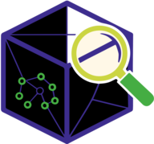

# Zolletta-metaskill



[](https://github.com/Zolletta/zolletta-metaskill/actions/workflows/tests.yml)
[](https://codecov.io/gh/Zolletta/zolletta-metaskill/branch/main)
[](https://www.python.org/downloads/)
[](LICENSE)
[](https://github.com/Zolletta/zolletta-metaskill/pulls)
[](https://metaskill.zolletta.org/)
[](https://github.com/Zolletta/zolletta-metaskill/releases)

A family of generic code review skills with specializations for Python and PHP (other languages in progress).

*Zolletta* is Italian for sugar cubes — each skill is a compact, self-contained piece that sweetens the review process. Together they dissolve into a complete picture.

Zolletta-metaskill is a **meta-skill**: it dispatches to subcommands that each perform a specific review task. It leverages [tokensave](https://github.com/aovestdipaperino/tokensave) when available for semantic code-graph queries, and falls back to grep + targeted reads otherwise.

If you maintain rules as part of your agent configuration, those are the single source of truth for their domain and apply to every subcommand. Subcommands link back to them and only narrow behavior for their specific review context. Zolletta-metaskill **complements** your rules — it does not override them.

📖 **Full documentation**: <https://metaskill.zolletta.org/>

## Installation

```bash
npx skills add zolletta/zolletta-metaskill
```

The `skills` CLI copies the bundle from `skills/zolletta-metaskill/` to `~/.agents/skills/zolletta-metaskill` and links it into every detected AI agent tool's skills directory (Claude Code, Cursor, Gemini CLI, Devin, OpenCode, Windsurf, and others). Pin a release with `npx skills add zolletta/zolletta-metaskill#v3.7.0`, update with `npx skills update zolletta-metaskill`, remove with `npx skills remove zolletta-metaskill`. See the [install guide](https://metaskill.zolletta.org/how-to/install/) for details and manual alternatives.

## Usage

After installation, navigate to a project and run a full review:

```text
cd /path/to/your/project
/zolletta-metaskill review
```

The first time you run any subcommand in a project, the **setup guard** automatically runs `/zolletta-metaskill setup` if `.zolletta-metaskill/settings.json` does not exist.

The orchestrator detects the language, runs all applicable skills in parallel, and writes reports to `.zolletta-metaskill/<timestamp>/reports/`. Start with `SUMMARY.md` for the overall grade and `TODO.md` for prioritized action items.

For a focused review, run a single subcommand:

```text
/zolletta-metaskill patterns         # God classes and SOLID
/zolletta-metaskill documentor        # documentation review
/zolletta-metaskill grice             # Grice maxims over the doc corpus
/zolletta-metaskill python-code-style # Python style only
```

New to Zolletta-metaskill? Read the [getting started tutorial](https://metaskill.zolletta.org/tutorials/getting-started/).

## API

Zolletta-metaskill exposes no library API — it is a set of agent skills driven from the command line. The interface is the `/zolletta-metaskill <subcommand>` invocation, where `<subcommand>` selects exactly one skill: `setup`, `review`, `patterns`, `documentor`, `grice`, `python-code-style`, `python-testing-style`, `php-code-style`, `php-testing-style`, `adr-distiller`, or `help`.

Each subcommand is self-contained: it reads its thresholds and scan roots from `.zolletta-metaskill/settings.json`, runs the scanners under `skills/zolletta-metaskill/src/zolletta_metaskill/`, and writes a report into the run folder. The scanners are plain scripts with a `[--json]` flag and no positional arguments, so they can also be run directly from the repository root in CI or for dogfooding. See the [subcommands reference](https://metaskill.zolletta.org/reference/subcommands/) for the dispatch contract and the [scripts reference](https://metaskill.zolletta.org/reference/code/scripts/) for the command-line contract.

## Contributing

See [CONTRIBUTING.md](CONTRIBUTING.md) for development setup, testing, and the quality gate.

## License

MIT + Commons Clause. See [LICENSE](LICENSE) and the `license` field in each subcommand's `SKILL.md` frontmatter.

## Attributions

- **[wshobson/agents](https://github.com/wshobson/agents)** (MIT, Copyright (c) 2024 Seth Hobson) — `python-code-style` and `python-testing-style` skills adapted from the original Python review agents. Design pattern principles in `patterns` also adapted from wshobson's python-design-patterns
- **[Diátaxis Documentation Expert](https://github.com/github/awesome-copilot/blob/main/skills/documentation-writer/SKILL.md)** (MIT, github/awesome-copilot) — `documentor` skill derived from this documentation review skill
- **[Doc Drift Detector](https://github.com/borghei/Claude-Skills/blob/main/engineering/doc-drift-detector/SKILL.md)** (MIT + Commons Clause, borghei/Claude-Skills) — drift detection pipeline in `documentor` derived from this skill
- **[Diátaxis](https://diataxis.fr/)** — documentation framework used by the `documentor` subcommand for structure compliance checks
- **[tokensave](https://github.com/aovestdipaperino/tokensave)** — semantic code-graph MCP server leveraged for code exploration when available
- **[Architectural Governance at AI Speed](https://www.infoq.com/articles/architectural-governance-ai-speed/)** (InfoQ, 2026) — ADR distiller design inspired by this article's declarative architectural governance approach
- **[Augmented Coding Patterns](https://lexler.github.io/augmented-coding-patterns/)** (lexler) — subcommand architecture rationale informed by the Focused Agent pattern and Distracted Agent anti-pattern
